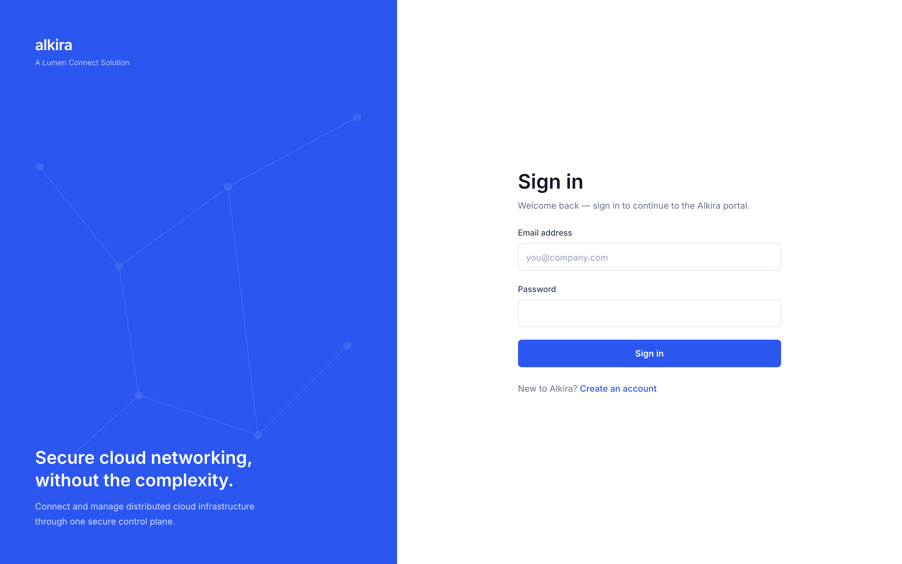
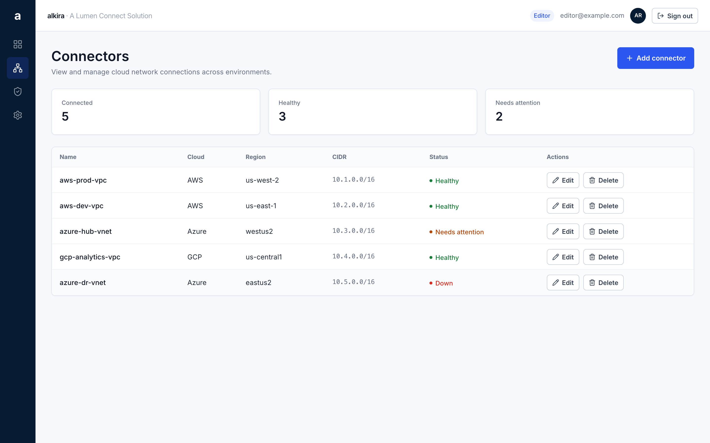
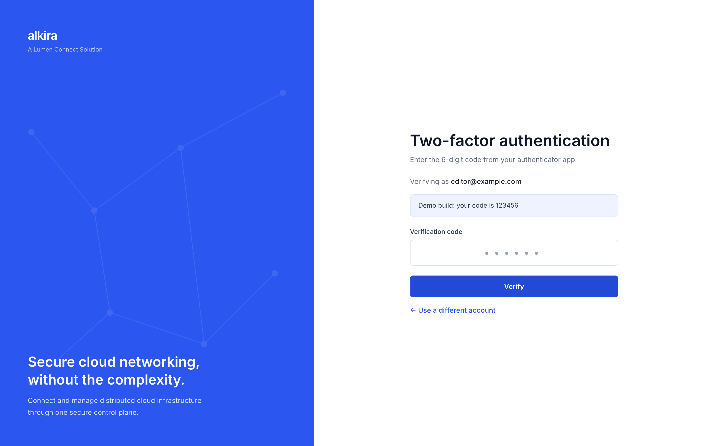

# Alkira UI Take-Home — Login + MFA + Access Control

Submission for Alkira's Software Engineer (UI Developer) exercise: a React app
demonstrating a login → MFA → protected screen flow, form validation with
deliberate error timing, and role-based access control, styled to an
Alkira-inspired enterprise design system.

> **Branding note:** this is a public repository, so no Alkira assets are used.
> The wordmark is plain text, the favicon is self-made, and the visual language
> follows the brand spec in [docs/](docs/) without copying anything.




## Technologies

| Tool | Why |
|---|---|
| React 19 + TypeScript (`strict`) | Auth state is a discriminated union — reading a user before MFA passes is a compile error, not a runtime bug |
| Vite 8 | Instant dev server; one bundler (Rolldown) for dev and build alike |
| react-router 7 | Every auth state has a URL; guards live at the route layer |
| react-hook-form + zod | The schema is the single source of truth for rules *and* types; uncontrolled inputs keep typing render-free |
| Tailwind v4 | Utility styling over spec-derived design tokens; config lives in CSS |
| Vitest + React Testing Library | Tests assert behaviour and ARIA state, never markup or pixels |
| Inter (self-hosted) + Lucide icons | Per the design spec; no runtime font/CDN fetches |

## Setup

Requires Node 20.19+ or 22.12+ (Vite 8's floor).

```bash
npm ci             # reproducible install from the lockfile
npm run dev        # http://localhost:5173
```

```bash
npm test           # 59 tests
npm run lint
npm run build      # typecheck + production build
```

## Demo credentials

| Email | Password | MFA code | Role |
|---|---|---|---|
| `viewer@example.com` | `Alkira123!` | `123456` | Read-only |
| `editor@example.com` | `Alkira123!` | `123456` | Read/write |

The MFA code is also printed on the MFA screen — a mock second factor secures
nothing, so hiding its code would only make the app tedious to explore.

## Testing the login/MFA flow

1. Start at `/login`. Submit empty to see both required errors; type a malformed
   email and leave the field to see validation fire on blur, then clear itself
   per keystroke once fixed.
2. Try a wrong password: one generic "Invalid email or password" — the mock API
   returns the same `null` for wrong email and wrong password, so the UI cannot
   leak which half was wrong.
3. Sign in as either account (email is case- and whitespace-insensitive). You
   land on `/mfa`, which knows who is pending and offers an escape hatch.

   
4. Enter the code. As **viewer**: a read-only banner, no Add button, Edit/Delete
   visible but disabled with a tooltip. As **editor**: add, inline-rename, and
   delete all work against in-memory state.
5. Worth trying deliberately: deep-link `/connectors` while logged out (→
   login), deep-link `/mfa` with no pending login (→ login), refresh mid-flow
   (→ logged out, by design), press Back to `/mfa` after finishing (→ forwarded,
   never re-challenged).

The same journeys exist in executable form in
[src/flow.test.tsx](src/flow.test.tsx).

## Key design decisions

The five that shape everything (full reasoning, including rejected alternatives
and costs, in **[DECISIONS.md](DECISIONS.md)**; build order in
[PLAN.md](PLAN.md)):

1. **Auth is a three-state machine** — `anonymous | awaitingMfa | authenticated`
   as a discriminated union behind `useReducer` + context. `user` does not exist
   on `anonymous`, so unearned access is unrepresentable; the pure reducer
   ignores illegal transitions, so no dispatch sequence skips the password step.
2. **Every flow state has a URL**, including `/mfa` — independently linkable,
   testable, guardable, and it forces the deep-link and refresh questions that a
   modal would hide.
3. **Route protection is positional** — pages nested under `<ProtectedRoute>`
   are guarded by where they sit, and the guard demands `authenticated`, not
   just "a user exists": the half-authenticated state is exactly what a naive
   check waves through.
4. **The UI asks capabilities, never roles** — `can(user, 'connector:edit')`
   against one policy table. Row actions are *disabled* for viewers (a boundary
   meant to be understood); creation is *hidden* (a workflow the viewer does not
   have). Both gating patterns, each where it belongs.
5. **Mock the data, never the transitions** — fixed users, fixed OTP, in-memory
   state. Refresh logs you out deliberately: with no server there is no session
   to restore, and persisting the client's own claim about identity would
   imitate a guarantee this app cannot make.

## AI usage

Built with Claude (Claude Code) as a pair-designer under a strict loop: every
decision was argued in plain language — with rejected alternatives and costs —
and approved before any code was written. [DECISIONS.md](DECISIONS.md) is that
record, and the git history shows the same sequence. I can walk through and
defend any line in the repo.

## Known limitations

- **None of this is security.** Every check is client-side and advisory; the
  bundle can be edited and there is no server to refuse anything. Real
  enforcement belongs server-side on every request — the client's job here is
  not showing users doors they cannot open.
- Auth state is in-memory: refresh returns to login (deliberate; see decision 5).
- The backend is a mock module (`src/lib/auth-api.ts`) with plaintext demo
  credentials — it is the seam where real HTTPS calls would go.
- Sign-up is a navigable stub; registration is explicitly out of scope in the
  exercise brief.
- On phones the connectors table scrolls horizontally rather than stacking into
  cards — a deliberate trade to keep real table semantics for screen readers.
- Light theme only: the design spec defines one look, and a derived dark
  palette would be guesswork.

## Demo

**▶ [Watch the demo (~3 min)](https://youtu.be/Xi3OWhspCN4)**

It covers a fresh `git clone` to a running app, validation and error handling,
the viewer journey (login → MFA → read-only connectors), the editor journey
(add, rename, delete), and the deliberate session loss on refresh.
